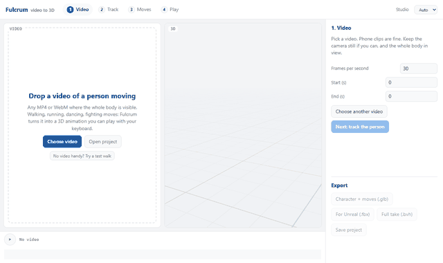
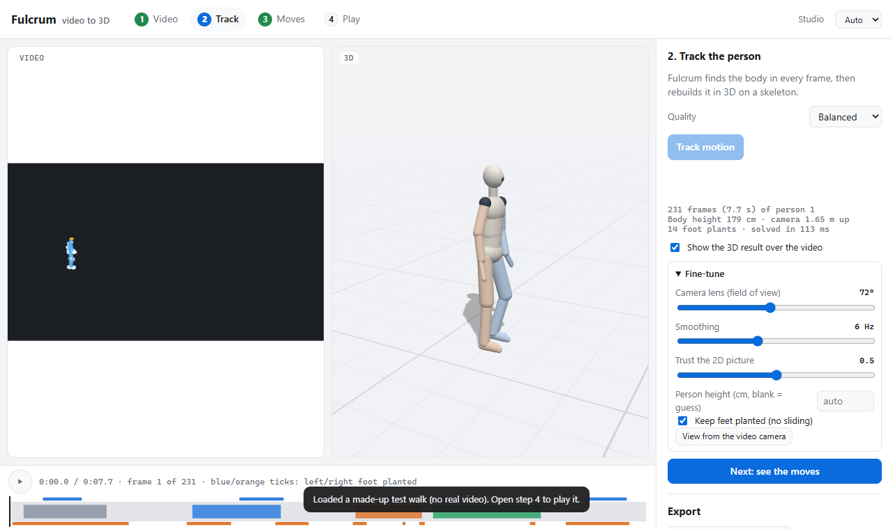
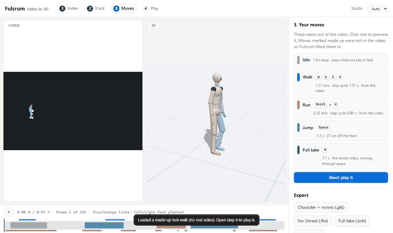
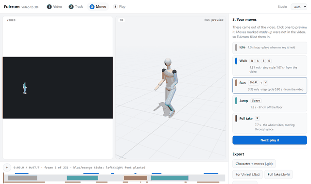

# Fulcrum screens and controls

This page explains what each part of the Fulcrum window does. The GIFs use the app's built-in test walk, so no real person is shown.

The app has four steps, shown in the top bar: **1 Video**, **2 Track**, **3 Moves**, **4 Play**. Each step has its controls in the right-hand panel, and a *Next* button at the bottom of that panel moves you on.

## The screen at a glance

- **Top bar:** the four steps, a *Studio* link, and the appearance setting.
- **Left (Video):** your clip. The blue lines drawn over it show the 3D result.
- **Middle (3D):** the character. This is what you play with.
- **Bottom (timeline):** play and pause, the time, and the list of moves.
- **Right (side panel):** the controls for the current step, and *Export* at the bottom.

## Try it without a video

Click **No video handy? Try a test walk** on the Video step. The app loads a made-up walk and goes straight to step 3, so you can see the whole app in a few seconds.

## Top bar

- **Steps 1 to 4:** jump between steps. The number turns green once that step is done.
- **Studio:** opens the older animation clean-up tool (`studio.html`).
- **Appearance:** *Auto* follows your computer, *Light* and *Dark* force a look.

## Step 1: Video

Drop a video onto the left side, or use the buttons:

- **Choose video:** pick an MP4 or WebM file from your computer.
- **Open project:** reopen a project you saved earlier, without tracking again.

After a video loads, the side panel shows:

- **Frames per second:** how many pictures the video has each second. The default is 30. Set it to match your clip.
- **Start (s) and End (s):** cut off the beginning and end of the clip.
- **Choose another video:** pick a different file.
- **Next: track the person:** becomes active once a video is loaded.

## Step 2: Track

Press **Track motion**. Fulcrum finds the body in every frame and builds it into 3D on a skeleton (a stick-figure frame of bones and joints).

- **Quality:** *Fast* is quickest, *Balanced* is the default, *Best (slow)* is the most careful.
- **Track motion:** starts the work. **Cancel** appears while it runs and stops it.
- **Progress bar and status line:** show how far along the work is.
- **Result lines (under the button):** the number of frames, the person's height, the camera's height, how many times a foot touched the floor, and how long the work took.
- **Show the 3D result over the video:** draws the blue skeleton on the video so you can check it lines up.
- **Next: see the moves:** active once tracking is done.

If the video has more than one person and Fulcrum picked the wrong one, click the right person in the video.

### Fine-tune (folded section)

Open it with the *Fine-tune* arrow. Only change these if the result looks wrong.

- **Camera lens (field of view):** how wide the camera lens was. Use a wider setting for phone wide-angle clips.
- **Smoothing:** how much the motion is smoothed. Lower numbers give smoother motion but can soften quick moves.
- **Trust the 2D picture:** how closely the 3D result must follow what the camera sees. Higher follows it more closely.
- **Person height (cm):** type the real height for exact sizes and speeds. Leave it blank to let Fulcrum guess.
- **Keep feet planted (no sliding):** stops the feet from slipping on the floor.
- **View from the video camera:** shows the 3D view from the camera's own point of view.

## Step 3: Moves

Fulcrum lists the moves it found in the video. Each card shows:

- **The name** (Idle, Walk, Run, Jump, or Full take).
- **The key that plays it** (for example W A S D for Walk).
- **Its speed or length**, and where it came from.

- **Click a move** to preview it in the 3D view.
- **from the video:** the move is taken from your clip.
- **made up:** the clip did not have this move, so Fulcrum filled it in.
- **sped-up walk / slowed run:** a run was made from the video's walk played faster, or a walk was made from a run played slower.
- **Idle:** plays when no key is held.
- **Full take:** the whole motion of the clip, moving through space. Press R to play it.
- **Next: play it:** moves to step 4.

## Step 4: Play

Press **Start playing**. The camera follows the character. Press **Stop playing** to leave.

- **Key list:** shows which key does what. It updates when you pick a different move.
- **Character:** choose the built-in *Mannequin*, or load your own.
- **Load your character (GLB, glTF or FBX):** use a 3D character with a human-shaped skeleton. Fulcrum plays the moves on it.

### Keys in play mode

| Key | What it does |
| --- | --- |
| W A S D or arrow keys | Move, relative to the camera |
| Shift (hold) | Run |
| Alt (hold) | Slow walk |
| Space | Jump |
| Q | Pick the next move (Shift+Q picks the previous one) |
| E or left click | Play the picked move |
| 1 to 9, 0 | Play move 1 to 9 (0 plays move 10) |
| R | Replay the whole video's motion |
| F | Full screen |
| Mouse drag / wheel | Look around / zoom |
| Esc | Stop a move, or leave play mode |

## The 3D view

- **Top right corner:** the name of the move that is playing now (for example *standing*).
- **Key strip at the bottom:** a short reminder of the main keys. It appears in play mode.

## Timeline (bottom)

- **Play / pause button:** starts or pauses the video. Space does the same.
- **Time text:** the current time, the frame number, and a note about which foot is on the floor.
- **Coloured bars:** each move in the clip. Grey is Idle, blue is Walk, orange is Run, green is Jump.
- **Small ticks along the bottom:** show when each foot touches the floor (blue for left, orange for right).

## Export

The buttons at the bottom of the side panel are greyed out until there is something to export.

- **Character + moves (.glb):** your character with every move as a separate animation. Opens in Blender, Unreal 5 and most 3D viewers.
- **For Unreal (.fbx):** the same thing in FBX format, for Unreal and most 3D apps. Needs Blender installed. A copy is kept in the `exports/` folder.
- **Full take (.bvh):** the whole tracked motion, in centimetres, with Mixamo bone names.
- **Save project:** keeps the tracking result. Reopen it later with **Open project** on step 1.

## Words used in the app

- **Skeleton:** the set of bones and joints that the 3D character moves with.
- **GLB, glTF, FBX:** common 3D file formats. GLB and glTF are good for web and Blender. FBX is common for Unreal.
- **BVH:** a simple motion file that stores only the movement, not the character.
- **Frames per second (fps):** how many pictures make up one second of video.
